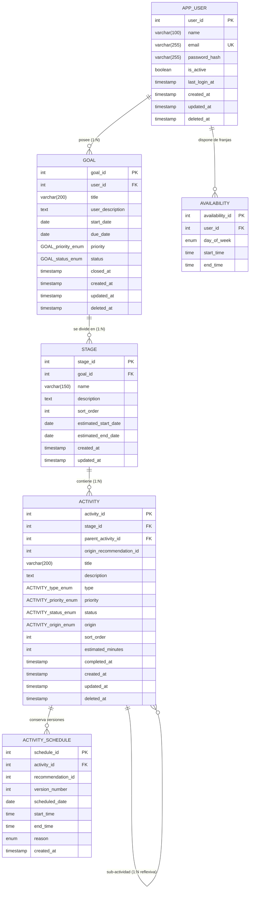

# Módulo de Base de Datos - FlowStep (Sprints 1 y 2)

Este módulo contiene los esquemas DDL, vistas, migración del Sprint 2, datos de demostración y pruebas de PostgreSQL de **FlowStep**. El Sprint 2 cubre HU-06, HU-07, HU-11, HU-13, HU-14, HU-16, HU-35 y HU-36, según el ER y las entidades existentes del backend.

---

## 1. Arquitectura de Base de Datos

* **Motor:** PostgreSQL 15 (Alpine)
* **Contenedor:** Docker Compose (`backend/docker-compose.yml`)
* **Mapeo ORM:** TypeORM (NestJS)
* **Principio de Diseño:** *"Derived data is NOT stored: it is computed with views"*. El progreso de objetivos y etapas no se persiste en columnas calculadas; se deriva en tiempo real a través de vistas SQL optimizadas.

---

## 2. Diagrama Entidad - Relación (alcance de los Sprints 1 y 2)



---

## 3. Vistas de Negocio (HU-03)

### `v_goal_progress` / `V_GOAL_PROGRESS`
Calcula el progreso de cada objetivo sumando los minutos estimados de las tareas completadas y dividiéndolos entre el total de minutos estimados del objetivo.

$$\text{progress\_percentage} = \left(\frac{\sum \text{estimated\_minutes (actividades completadas)}}{\sum \text{estimated\_minutes (todas las actividades)}}\right) \times 100$$

* Si un objetivo no tiene actividades o la suma total de minutos es 0, retorna `0.00%`.
* No toma en cuenta actividades borradas lógicamente (`deleted_at IS NOT NULL`).
* Es compatible tanto con consultas sin comillas (`SELECT * FROM v_goal_progress;`, `SELECT * FROM V_GOAL_PROGRESS;`) como con consultas entre comillas (`SELECT * FROM "V_GOAL_PROGRESS";`).

Columnas retornadas:
* `goal_id`, `user_id`, `goal_title`, `goal_status`
* `total_activities`
* `completed_activities`
* `total_estimated_minutes`
* `completed_estimated_minutes`
* `progress_percentage` (numérico redondeado a 2 decimales)

### `v_stage_progress` / `V_STAGE_PROGRESS`
Aplica el mismo cálculo proporcional a nivel de cada etapa individual para permitir visualización en barras de progreso por fase.

---

## 4. Estructura de Scripts y Ejecución

```
database/
├── 01_schema.sql  # Creación de enums, tablas, restricciones, índices y triggers
├── 02_views.sql   # Vistas analíticas (v_goal_progress, v_stage_progress y alias)
├── 03_seeds.sql   # Datos de prueba con casos al 50%, 100% y 0%
├── 04_sprint2_schema.sql # Migración aditiva: disponibilidad y cronogramas
├── 05_sprint2_views.sql  # Tiempo disponible, programación vigente y compatibilidad
├── 06_sprint2_seeds.sql  # Demo independiente del Sprint 2
├── tests/
│   ├── sprint2.sql # Pruebas de integridad y de las ocho HU con ROLLBACK
│   └── backend.integration.cjs # Servicios y entidades reales contra PostgreSQL
└── README.md      # Este documento
```

### Ejecución con Docker Compose (Automática)
Desde la carpeta `backend`:
```bash
cd backend
# Iniciar PostgreSQL (los scripts se ejecutan si el volumen es nuevo):
docker compose up -d db
```
El contenedor monta `../database` en `/docker-entrypoint-initdb.d:ro` y ejecuta los seis scripts raíz en orden. PostgreSQL solo inicializa volúmenes vacíos; un volumen existente debe actualizarse con la migración descrita abajo. No hace falta eliminar el volumen ni sus datos. Las pruebas están en una subcarpeta y no se ejecutan durante la inicialización.

### Ejecución Manual con `psql`
```bash
psql -v ON_ERROR_STOP=1 -U postgres -d flowstep_db -f database/01_schema.sql
psql -v ON_ERROR_STOP=1 -U postgres -d flowstep_db -f database/02_views.sql
psql -v ON_ERROR_STOP=1 -U postgres -d flowstep_db -f database/03_seeds.sql
psql -v ON_ERROR_STOP=1 -U postgres -d flowstep_db -f database/04_sprint2_schema.sql
psql -v ON_ERROR_STOP=1 -U postgres -d flowstep_db -f database/05_sprint2_views.sql
psql -v ON_ERROR_STOP=1 -U postgres -d flowstep_db -f database/06_sprint2_seeds.sql
```

### Consulta de Verificación
```sql
SELECT goal_id, goal_title, total_activities, completed_activities, total_estimated_minutes, completed_estimated_minutes, progress_percentage 
FROM v_goal_progress 
ORDER BY goal_id;
```

**Resultado esperado con los seeds:**
| goal_id | goal_title | total_activities | completed_activities | total_min | completed_min | progress_percentage |
| :---: | :--- | :---: | :---: | :---: | :---: | :---: |
| 1 | Dominar NestJS y Arquitectura Limpia | 4 | 2 | 240 | 120 | **50.00%** |
| 2 | Diseño de Vistas y Optimización en PostgreSQL | 3 | 3 | 120 | 120 | **100.00%** |
| 3 | Diseño de Interfaz de Usuario para FlowStep Mobile | 2 | 0 | 210 | 0 | **0.00%** |

---

## 5. Observaciones y Recomendaciones para el Backend

Para asegurar una integración perfecta entre el equipo de Base de Datos y el equipo de Backend, se detallan las siguientes consideraciones técnicas:

1. **Consumo de la vista `v_goal_progress` en NestJS (HU-03):**  
   Actualmente el backend no expone un endpoint que retorne el porcentaje de avance de las metas. Se recomienda al equipo de backend:
   - Crear una entidad de vista en TypeORM `@ViewEntity({ name: 'v_goal_progress' })` o inyectar el DataSource para consultar `SELECT * FROM v_goal_progress WHERE goal_id = $1`.
   - Exponer esta información en `GET /goals/:id` o mediante un endpoint dedicado `GET /goals/:id/progress`.

2. **Compatibilidad de enums:**  
   Se mantienen los nombres que ya usa TypeORM, incluidos `GOAL_priority_enum` y `ACTIVITY_priority_enum`. Los tipos nuevos son `AVAILABILITY_day_of_week_enum` y `ACTIVITY_SCHEDULE_reason_enum`. El dominio lógico del ER es el mismo; no se renombra un tipo que el backend ya utiliza.

3. **Configuración de `synchronize`:**  
   En `app.module.ts`, la sincronización automática está desactivada por defecto y solo se activa explícitamente con:
   ```typescript
   synchronize: process.env.DB_SYNCHRONIZE === 'true'
   ```
   Mantener `DB_SYNCHRONIZE=false` (o sin definir) al usar los scripts SQL para evitar que TypeORM altere objetos administrados por BD. El backend requiere que el esquema se haya inicializado antes de arrancar.

## 6. Actualizar una base existente al Sprint 2

Con el Sprint 1 ya aplicado, ejecutar desde la raíz del repositorio y con el backend detenido:

```powershell
docker compose -f backend/docker-compose.yml up -d db
docker compose -f backend/docker-compose.yml exec -T db psql -v ON_ERROR_STOP=1 -U postgres -d flowstep_db -f /docker-entrypoint-initdb.d/04_sprint2_schema.sql
docker compose -f backend/docker-compose.yml exec -T db psql -v ON_ERROR_STOP=1 -U postgres -d flowstep_db -f /docker-entrypoint-initdb.d/05_sprint2_views.sql
# Opcional: agregar la demostración, sin modificar los ejemplos del Sprint 1.
docker compose -f backend/docker-compose.yml exec -T db psql -v ON_ERROR_STOP=1 -U postgres -d flowstep_db -f /docker-entrypoint-initdb.d/06_sprint2_seeds.sql
```

Si el contenedor existente aún no tiene el nuevo montaje, `up -d` lo recrea conservando su volumen. También se pueden ejecutar los mismos archivos con `psql -f` desde el equipo.

`04` y `05` se pueden volver a aplicar. `04` añade las tablas si faltan y agrega los CHECKs incluso si TypeORM había creado las tablas del Sprint 2. No modifica filas existentes: si encuentra intervalos o valores inválidos, revierte toda esa migración para que puedan revisarse. No convierte esquemas arbitrarios ni enums con valores diferentes; presupone el Sprint 1 y las entidades actuales del backend. `06` evita duplicar su usuario, objetivo, etapa, actividades, franjas y versiones al repetirlo; se reserva exclusivamente para desarrollo y demostración.

## 7. Cobertura del Sprint 2

| Historia | Soporte de base de datos |
| --- | --- |
| HU-06 | `GOAL.priority` admite `high`, `medium`, `low`; reutiliza el enum del Sprint 1. |
| HU-07 | `v_availability_detail` deriva minutos por franja; `v_user_available_time` suma minutos semanales. |
| HU-11 | `ACTIVITY` permite editar campos, duración y orden; se conservan CHECKs y vistas de progreso. |
| HU-13 | `ACTIVITY.origin = 'manual'`, estado inicial `pending` y relación con `STAGE`. |
| HU-14 | `ACTIVITY_SCHEDULE` conserva filas por versión, con unicidad `(activity_id, version_number)`, versión positiva y fecha obligatoria. |
| HU-16 | `ACTIVITY.status = 'pending'` y `completed_at = NULL`, como escribe el servicio del backend. |
| HU-35 | `AVAILABILITY`, enum de siete días de lunes a domingo, FK a usuario, fin posterior al inicio y unicidad por usuario/día/inicio. |
| HU-36 | Programación inicial y ajustes, duraciones en actividades y vista de compatibilidad con la disponibilidad real. |

No se agregan tablas de otros sprints del ER. `recommendation_id` queda nullable y sin FK hasta implementar `AI_RECOMMENDATION`, igual que en la entidad actual. La creación de horarios y el cálculo de la siguiente versión siguen a cargo del backend; SQL rechaza duplicados concurrentes, pero no reintenta la solicitud.

### Vistas nuevas

Todas tienen un alias equivalente entre comillas en mayúsculas. También hay alias `availability` y `activity_schedule` para las dos tablas.

* `v_availability_detail`: franjas de usuarios no eliminados y `available_minutes`, calculados con precisión de segundos.
* `v_user_available_time`: `user_id`, `total_slots`, `available_days`, `weekly_available_minutes`. Incluye usuarios sin franjas con ceros. La suma es nominal: el backend actual permite franjas que se solapen si empiezan a horas distintas; este sprint conserva ese contrato y no calcula la unión de intervalos.
* `v_activity_current_schedule`: una fila por actividad programada, eligiendo el mayor `version_number`. Excluye actividades, objetivos y usuarios eliminados lógicamente; una actividad aún sin programación no aparece.
* `v_activity_availability_fit`: programación vigente y `fits_availability`. Es `true` si día, horas y minutos estimados caben en una franja; `false` si no caben; `NULL` si falta disponibilidad, duración u horario completo. Verifica cada actividad, no conflictos entre actividades diferentes. No realiza llamadas a IA ni reprograma.

Las horas de cronogramas siguen siendo opcionales de forma independiente, como en el DTO del backend. Las restricciones no dependen de la disponibilidad actual: cambiar o borrar la rutina no debe borrar ni invalidar el historial. Las vistas de progreso del Sprint 1 no se unen a versiones de cronogramas y conservan su fórmula.

El borrado lógico conserva los cronogramas. El borrado físico de usuario/objetivo/etapa/actividad propaga `ON DELETE CASCADE`, conforme a las entidades del backend; el historial no es una auditoría inmutable después de un borrado físico.

### Demostración

`06_sprint2_seeds.sql` crea `sprint2.demo@flowstep.test` con contraseña `Password123!`, un objetivo de prioridad alta, una actividad planificada y una propia pendiente. La rutina suma **150 minutos** (lunes 60, miércoles 60, viernes 30). La actividad planificada tiene versiones `initial_plan`, `user_reschedule` y `ai_adjustment`; la vista vigente devuelve la versión 3. Los planes de esta demo son simulados y deterministas.

```sql
SELECT * FROM v_user_available_time
WHERE user_id = (SELECT user_id FROM "APP_USER" WHERE email = 'sprint2.demo@flowstep.test');

SELECT activity_title, version_number, scheduled_date, fits_availability
FROM v_activity_availability_fit
WHERE user_id = (SELECT user_id FROM "APP_USER" WHERE email = 'sprint2.demo@flowstep.test');
```

## 8. Pruebas

Ejecutar sobre una base de pruebas que tenga `01`, `02`, `04` y `05` aplicados (los seeds no son necesarios):

```powershell
psql -v ON_ERROR_STOP=1 -U postgres -d flowstep_sprint2_test -f database/tests/sprint2.sql
```

El script crea sus propias filas, verifica las ocho historias y casos inválidos, y termina con `ROLLBACK`. Como en cualquier transacción PostgreSQL, las secuencias pueden avanzar aunque se reviertan las filas. Un fallo produce un error de `psql`.

Para comprobar las entidades y servicios reales, instalar previamente las dependencias del backend y conectar un PostgreSQL temporal en un puerto local. Esta prueba solo acepta la base `flowstep_sprint2_test` en `127.0.0.1`:

```powershell
$env:FLOWSTEP_TEST_PORT = '55432' # Puerto del PostgreSQL temporal
$env:FLOWSTEP_TEST_PASSWORD = 'sprint2_test'
node database/tests/backend.integration.cjs
```

La integración usa `GoalsService`, `ActivitiesService` y `AvailabilityService` reales con TypeORM y `synchronize: false`. Solo sustituye Gemini por una respuesta fija, y revierte las filas al finalizar. No arranca la API ni modifica una base de uso cotidiano.

### PostgreSQL temporal con Docker (sin usar el volumen de desarrollo)

Desde la raíz del repositorio, este ejemplo crea un contenedor independiente en el puerto 55432 y almacena sus datos en memoria:

```powershell
$sprint2Scripts = (Resolve-Path database).Path
docker run --detach --rm --name flowstep-sprint2-test --publish 127.0.0.1:55432:5432 --tmpfs /var/lib/postgresql/data --env POSTGRES_PASSWORD=sprint2_test --env POSTGRES_DB=flowstep_sprint2_test --mount "type=bind,source=$sprint2Scripts,target=/docker-entrypoint-initdb.d,readonly" postgres:15-alpine
docker exec flowstep-sprint2-test pg_isready -U postgres -d flowstep_sprint2_test
```

Esperar a que termine la inicialización y `pg_isready` indique que acepta conexiones; después ejecutar:

```powershell
docker exec flowstep-sprint2-test psql -v ON_ERROR_STOP=1 -U postgres -d flowstep_sprint2_test -f /docker-entrypoint-initdb.d/tests/sprint2.sql
$env:FLOWSTEP_TEST_PORT = '55432'
$env:FLOWSTEP_TEST_PASSWORD = 'sprint2_test'
node database/tests/backend.integration.cjs
# El contenedor temporal y sus datos se eliminan al detenerlo:
docker stop flowstep-sprint2-test
```
